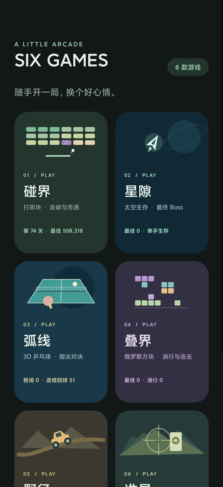
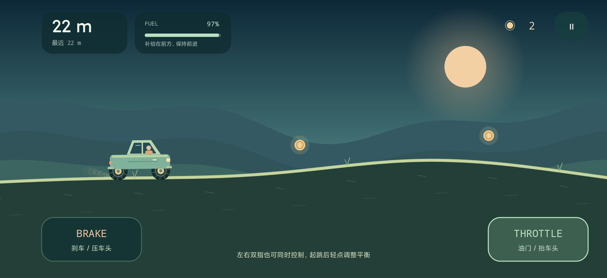
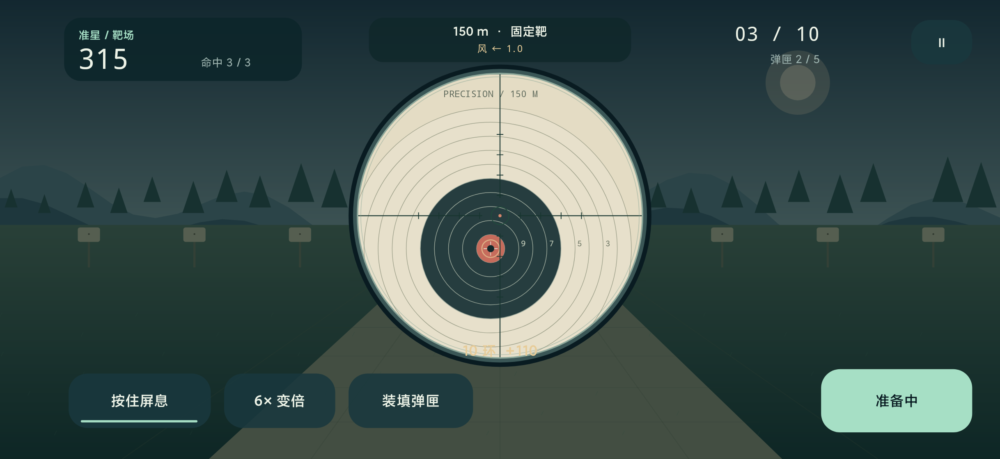

# SIX GAMES

一个完全离线的 Android 小游戏集：碰界打砖块、星隙太空生存、弧线 3D 乒乓球、叠界俄罗斯方块、野径登山赛车、准星狙击打靶。六张卡片直接进入各款游戏，神秘砖块把碰界与星隙串成连续奇遇。

版本：**2.4.0**（`versionCode 11`）

包名：`dev.brickzen.app`

仓库：[Jeremy-Jia/Games](https://github.com/Jeremy-Jia/Games)

[下载当前 APK](releases/Games-2.4.0-release.apk)



 

## 六种玩法，一个入口

| 游戏 | 玩法 |
| --- | --- |
| 碰界 | 更小、更密的几何砖阵，加入改变球路的反弹障碍；滑动挡板、轻点发球，保留道具、连击、音效、触感、外观和挡板高度设置。 |
| 星隙 | 单手拖动飞船，自动瞄准开火，收集星尘进行三选一升级，蓄能释放冲击波。消灭六波敌人后迎战最终 Boss，没有通关倒计时。 |
| 弧线 | 3D 乒乓球，左右拖动球拍，自动接击，快滑改变落点。三档 AI、真实三维球路、球台反弹与球网判罚，11 分且领先 2 分获胜。 |
| 叠界 | 10×20 俄罗斯方块，7 袋随机、墙踢旋转、暂存、落点预览、软降／直落、连消与逐级提速；支持按钮与手势。 |
| 野径 | 横屏登山赛车，按住油门／刹车、双轮悬挂、腾空平衡、连续起伏山路、金币与燃油补给。 |
| 准星 | 横屏打靶，1×／3×／6×瞄准镜、拖动瞄准、按住屏息、后坐力、装填、逐步增加距离及移动靶，10 发一轮。 |
| 神秘砖块 | 随机藏在砖阵内部，避开最先接触的一排。击中后自动进入星隙，闯过四波敌人与最终 Boss；升级自动装配，结束自动发奖、返回并继续打球。 |

奇遇带回的额外分数限制在 `0–3000` 分。击败 Boss 还能获得 14 秒加宽挡板与满格能量；主动取消不会获得奖励，也不会扣除碰界的生命。成功、失败或提前退出都会自动返回原局，不需要领奖或点击继续。

2.2 按每波击破目标推进，最后才出现 Boss；不会因到达 30 秒或三分钟自动结束。敌人组合和弹幕逐波增强，界面显示当前目标与 Boss 血条。普通航程保留手动选择升级，奇遇保持连续战斗。障碍不会计入清关目标，也不会被道具消除。

应用没有广告、账号、联网功能或 Root 要求。仅使用震动权限；六款游戏各自保存设置和纪录。集锦入口沿用碰界的外观设置。桌面应用名和首页标题均为 **SIX GAMES**。

弧线使用三维物理与透视投影绘制球台、球网、球拍、球和阴影，不依赖游戏引擎或外部素材。采用街机规则，发球擦网计失误，没有正式比赛的擦网重发。叠界可点按按钮，也可在棋盘横滑移动、轻点旋转、下滑直落、上滑暂存。两款新游戏在后台或失焦时暂停；当前保存纪录与设置，不跨进程保存整局比赛／棋盘进度。

野径按住右侧油门前进，左侧刹车减速；腾空时油门抬车头、刹车压车头。准星拖动画面瞄准，按住屏息稳定准星，点击射击；5 发弹匣需要手动装填。靶场只有纸靶，风偏与下坠使用虚构的街机数值。两款横屏游戏在切出时冻结并释放触控，返回后手动继续；只保存纪录和设置，不跨进程保存当前行驶或打靶进度。

## 安装与存档

发布包位于 `releases/Games-2.4.0-release.apk`；自行构建的 APK 位于 `app/build/outputs/apk/`。

集锦继续使用原碰界包名和私有存档名 `brickzen`。**同包名、同签名的覆盖升级**可以保留原来的关卡、纪录与设置。签名不同的 APK 无法直接覆盖，不能通过先卸载来假定存档仍会保留。签名密钥与用户个人存档均不在本仓库中。

先前独立安装的星隙使用另一包名，Android 不会自动把那个应用的纪录搬入本游戏集。

## 构建

需要 JDK 17、Android SDK Platform 36 和 Build Tools 36.0.0。项目使用 Android Gradle Plugin 8.10.1，Gradle Wrapper 固定为 8.11.1。

配置 `JAVA_HOME` 和 `ANDROID_HOME`，或在本机 `local.properties` 中设置 `sdk.dir`。首次构建需要下载 Gradle 与 Android 构建依赖；依赖已缓存时可追加 `--offline`。

Windows：

```powershell
.\gradlew.bat assembleDebug
```

macOS / Linux：

```sh
./gradlew assembleDebug
```

调试包输出到 `app/build/outputs/apk/debug/app-debug.apk`。

需要使用自己的签名构建发布包时，在当前终端设置以下环境变量，再运行发布构建。不要把密码、密钥或个人绝对路径提交到 Git。

```powershell
$env:GAMES_SIGNING_STORE = 'C:\private\games-signing.jks'
$env:GAMES_SIGNING_ALIAS = 'your-key-alias'
$env:GAMES_SIGNING_PASSWORD = '<密钥库及密钥密码>'
.\gradlew.bat assembleRelease
```

发布构建输出到 `app/build/outputs/apk/release/app-release.apk`。当前配置让调试与发布构建共用指定密钥；未指定 `GAMES_SIGNING_STORE` 时使用本机 Android 默认 debug key。这只能保证本机构建的一致性，**不能保证覆盖另一台电脑或另一签名生成的已安装版本**。

本开发工作区另提供 `build.ps1`，复用相邻 `work/` 目录的 Gradle 和缓存；默认执行离线 Release 构建，读取版本号并复制为 `releases/Games-<版本>-release.apk`。其他电脑优先使用上述 Gradle Wrapper。

```powershell
.\build.ps1
# 调试版本：.\build.ps1 -Configuration Debug
# 允许下载依赖：.\build.ps1 -Online
```

## 测试

引擎测试不依赖 Android 运行环境，可以直接用 JDK 17 运行：

```powershell
New-Item -ItemType Directory -Force build/engine-tests | Out-Null
javac -encoding UTF-8 -d build/engine-tests `
  app/src/main/java/dev/brickzen/app/GameEngine.java `
  app/src/main/java/io/github/jeremyjia/stardrift/GameEngine.java `
  app/src/main/java/dev/brickzen/tabletennis/TableTennisEngine.java `
  app/src/main/java/dev/brickzen/blocks/BlocksEngine.java `
  app/src/main/java/dev/brickzen/hillclimb/HillClimbEngine.java `
  app/src/main/java/dev/brickzen/range/RangeEngine.java `
  tests/BrickEngineTest.java tests/GameEngineTest.java tests/BalanceProbe.java `
  tests/TableTennisEngineTest.java tests/BlocksEngineTest.java `
  tests/HillClimbEngineTest.java tests/RangeEngineTest.java
java -cp build/engine-tests dev.brickzen.app.BrickEngineTest
java -cp build/engine-tests GameEngineTest
java -cp build/engine-tests TableTennisEngineTest
java -cp build/engine-tests BlocksEngineTest
java -cp build/engine-tests HillClimbEngineTest
java -cp build/engine-tests RangeEngineTest
java -cp build/engine-tests BalanceProbe
```

测试覆盖密集砖阵与障碍碰撞、随机神秘砖、原局快照、奖励只领取一次、取消奇遇，以及星隙按击破推进、没有超时胜利、最终 Boss 和自动升级。`BalanceProbe` 用固定种子的模拟驾驶观察星隙平衡性，不能替代手动体验。

`test.ps1` 可一次运行六套引擎回归。测试还覆盖乒乓球的三维回球／球网／得分／加分赛、方块的 7 袋和旋转踢墙、赛车的双轮接地／刹车／燃油／翻覆，以及打靶的命中／弹匣／屏息／移动靶与轮次结算。

最新验收见 [2.4.0 记录](docs/verification/2.4.0.md)，乒乓球与方块初版见 [2.3.0](docs/verification/2.3.0.md)，完整 Boss 往返见 [2.2.0](docs/verification/2.2.0.md)。此前小米 15 限时版本记录保留在 [2.1.0](docs/verification/2.1.0.md)，初版恢复与集成记录见 [2.0.0](docs/verification/REPORT.md)。

原生往返测试使用 Android 自带 `Instrumentation`，无需第三方测试依赖：

```powershell
.\gradlew.bat assembleDebug assembleDebugAndroidTest
adb install -r app/build/outputs/apk/debug/app-debug.apk
adb install -r app/build/outputs/apk/androidTest/debug/app-debug-androidTest.apk
adb shell am instrument -w dev.brickzen.app.test/dev.brickzen.app.CollectionSmokeInstrumentation
```

部分系统会拦截安装新的测试辅助包。可改用临时 `selfTest` 变体，将同一个测试入口放在游戏自己的调试包内，以相同签名覆盖安装：

```powershell
.\gradlew.bat assembleSelfTest
adb install -r app/build/outputs/apk/selfTest/app-selfTest.apk
adb shell am instrument -w dev.brickzen.app/dev.brickzen.app.CollectionSmokeInstrumentation
# 乒乓球、方块、赛车、打靶测试：
adb shell am instrument -w dev.brickzen.app/dev.brickzen.app.CollectionAdditionsInstrumentation
```

测试完成后覆盖安装正常 Release 包即可移除内置测试入口；正式版本不包含测试代码或 instrumentation 声明。

设备须解锁并保持前台。测试会备份所涉及的游戏偏好，在 `finally` 中恢复并逐键核对；它会操作当前应用，请勿与手动游戏同时运行。测试与发布 APK 应使用同一签名，避免卸载造成存档丢失。

## 源码导航

```text
app/src/main/java/
├── dev/brickzen/app/                 碰界玩法、主题、集锦入口与跨游戏交接
│   ├── CollectionActivity.java       集锦首页
│   ├── MainActivity.java             碰界宿主与奇遇交接
│   ├── GameEngine.java               砖块物理、关卡、道具与局面快照
│   └── GameView.java                 碰界绘制、输入与原有设置
├── dev/brickzen/tabletennis/         弧线3D乒乓球物理、透视绘制与宿主
├── dev/brickzen/blocks/              叠界方块规则、界面与宿主
├── dev/brickzen/hillclimb/           野径车辆物理、山路绘制与横屏宿主
├── dev/brickzen/range/               准星弹道、靶场绘制与横屏宿主
└── io/github/jeremyjia/stardrift/     星隙引擎、界面、宿主与程序生成音效
app/src/main/res/                    碰界恢复资源与集锦主题
tests/                              纯 Java 回归与平衡探针
docs/                               恢复来源、架构与验收记录
releases/                           可安装 APK
```

原碰界 1.3.0 当时没有可拉取源码，本仓库以设备上用户自己的 APK 为依据恢复可构建工程，再加入游戏集功能。这不是原始注释或 Git 历史的恢复；详见 [恢复说明](docs/RECOVERY.md) 和 [架构说明](docs/ARCHITECTURE.md)。
